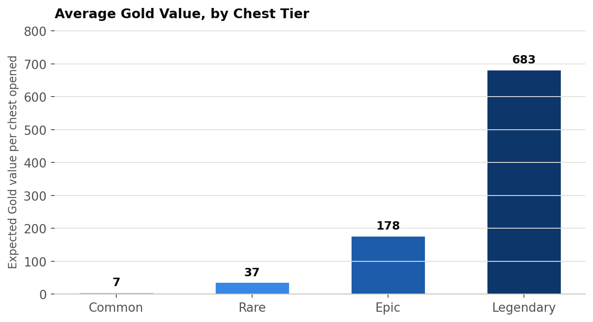

# Fishing Idle Game MMO — Game Design Overview

## Executive Summary

Fishing Idle Game MMO is a browser-based multiplayer idle fishing game. Players cast automatically from a shared dock, level up a fishing rod over ten levels, and collect fish, treasure chests, and gems in real time alongside other players in the same world. The core game loop — cast, catch, level up, open chests, appraise gems — is complete and fully playable today.

Bait, Gold and Pearl are earned entirely through play. The one exception is **USDG**, an in-game dollar balance that can be topped up by depositing USDC on the NEAR blockchain and spent on Gold. Deposits are switched off unless the operator configures a treasury account, and there is no way to withdraw. Players can play as guests or sign in with a NEAR wallet or MetaMask.

The design's central lever is **Stake**: a single dial, from 1 to 40, setting how much Bait a player commits to each cast. Raising it is the whole risk. A high Stake bites less often, and pays for that in rarer fish, better treasure, and chest tiers a low Stake can never reach. This trade-off is deliberately dramatic — modeling shows the top of the ladder generates **roughly 45 times more in-game wealth per hour** than the bottom (Section 8, Play Style Comparison). That gap is the intended design, not an imbalance.

This document describes the game exactly as it stands today, system by system, with the data behind its balancing.

## 1. Game Overview

| | |
| --- | --- |
| **What it is** | A shared, persistent fishing harbor — one continuous world all players fish in together |
| **Platform** | Runs in the browser, on desktop and mobile |
| **Getting started** | No account needed. A player picks a display name and is fishing within seconds |
| **World capacity** | Up to 8 players fishing in the same world at once |
| **Monetization** | Optional USDC deposits on NEAR into USDG, which buys Gold. Off unless a treasury account is configured. No withdrawals |
| **Accounts** | Guest by default. Optional sign-in with a NEAR wallet or MetaMask keeps the save with the wallet across devices |
| **What's live right now** | Fishing, rod progression, treasure chests, gem appraisal, a shop, chat, an online player list, a leaderboard, and wallet sign-in |

A guest's progress is tied to their browser — closing and reopening it picks up where they left off, but it doesn't move between devices. Signing in with a NEAR wallet or MetaMask ties the save to the wallet instead, so it follows the player to any device.

**Fairness by design.** Every catch, every chest, and every gem is decided on the server, never in the player's browser — so nothing a player's device does can influence an outcome in their favor. This is a deliberate integrity guarantee: what a player sees is what actually happened.

## 2. Core Gameplay Loop

Fishing runs automatically once a player turns it on. Each cast plays out in three steps:

1. **Cast.** The player's current risk setting (their Stake — see Section 4) is locked in the instant the cast begins, so changing it mid-cast can never affect that cast's outcome.
2. **Wait.** The cast plays out over a few seconds — faster with a better rod.
3. **Resolve.** The cast either lands a fish or doesn't. A landed fish may also come with a treasure chest.

A caught fish is not paid out immediately — it's held in the player's bag (up to 80 at a time) until the player chooses to cash it in for Fishing Power (the game's XP). This is a deliberate design choice: it gives players two separate things worth doing — fishing, and managing what they've caught — rather than one automatic payout loop.

## 3. Player Progression

Ten rod levels gate everything else in the game: how fast a player can fish, how often they catch something, how often they find treasure, and which fish they're even able to catch.

| Rod Level | Cast Time (seconds) | Catch Rate | Chest Chance | Fishing Power to Level Up | Gold Cost to Skip |
| --- | --- | --- | --- | --- | --- |
| 1 — Bamboo Rod | 4.0 | 55% | 1.3% | 1,120 | 672 |
| 2 — Willow Rod | 3.8 | 59% | 1.4% | 2,520 | 1,512 |
| 3 — Oak Rod | 3.6 | 63% | 1.5% | 4,550 | 2,730 |
| 4 — Fiberglass Rod | 3.4 | 66% | 1.7% | 7,800 | 4,680 |
| 5 — Reinforced Rod | 3.15 | 70% | 1.9% | 13,500 | 8,100 |
| 6 — Carbon Rod | 2.9 | 73% | 2.1% | 21,500 | 12,900 |
| 7 — Steelcore Rod | 2.65 | 76% | 2.3% | 38,200 | 22,920 |
| 8 — Tidecaller Rod | 2.35 | 79% | 2.4% | 70,500 | 42,300 |
| 9 — Stormbreaker Rod | 2.0 | 82% | 2.6% | 129,500 | 77,700 |
| 10 — Leviathan Rod (max) | 1.6 | 86% | 2.8% | — | — |

**Revised 2026-09-08.** The Fishing Power curve above was stretched considerably from an earlier version of this table (where Rod 1→2 cost only 50 XP). Measured play showed a brand-new player reaching Rod 3 in about fifteen minutes of casual cashing-in — fast enough that the early rods, which exist to introduce Stake, chests and appraisal, were often skipped past before a player had really used them. The new curve targets roughly half an hour for the first level and grows to roughly 12-13 hours for the last, for a floor of about **37 hours of continuous play** to reach Rod 10 (see the Appendix). "Floor" because that number assumes Stake 1 throughout; a player who raises their Stake as it unlocks (see Section 4) climbs faster.

A player who doesn't want to wait can skip straight to the next level for Gold — still priced at six-tenths of a Gold coin per point of Fishing Power skipped, which is now a materially bigger ask (672 Gold for the first level alone, against roughly 27-51 Gold/hour of typical early income — see `balance-tables.md`'s Hourly economy table). Whether that price should move independently of the XP curve is flagged as **open** — see Section 10.

Six fish species exist, and a rod unlocks access to a new one as it levels up:

| Fish | Rarity | Unlocks at Rod Level | Relative Abundance | Fishing Power per Catch |
| --- | --- | --- | --- | --- |
| Muddy Carp | Common | 1 | Very high | 4 |
| Speckled Trout | Common | 2 | High | 6 |
| Whiskered Catfish | Uncommon | 3 | Moderate | 8 |
| Golden Koi | Rare | 4 | Low | 16 |
| Moonfish | Epic | 5 | Very low | 32 |
| Leviathan | Legendary | 7 | Rarest | 64 |

All six species are unlocked well before max level (by Rod 7 of 10, moved up from Rod 8 alongside the 2026-09-08 XP revision so a new species keeps landing on levels that used to introduce nothing new), so the rarest fish are something players actively pursue for most of their progression, not a reward they only see at the very end.

## 4. The Stake

**Stake is the game's one risk lever.** A player picks a number — 1, 5, 10, 20, or 40 — and that number is how much Bait each cast commits. Nothing else in the game asks the player to choose how to play; this single dial is the whole strategic decision.

The lever runs in both directions at once. Raising the Stake does *not* simply buy a better cast for more Bait — it buys a **rarer, richer, less frequent** one:

| Stake | Bait per Cast | Catch Rate | Rare-Fish Odds | Fishing XP | Chest Chance | In short |
| --- | --- | --- | --- | --- | --- | --- |
| 1 — Shallows | 1 | +25% | Lowest | −5% | −15% | Steady bites, common catches |
| 5 — Inshore | 5 | +11% | Lower | −2.5% | +4% | A little rarer, a little less often |
| 10 — Open water | 10 | −2.5% | Standard | Standard | +23% | Even odds, and Legendary comes into reach |
| 20 — Deep water | 20 | −16% | Higher | +2.5% | +41% | Fewer bites, no more Common chests |
| 40 — Full send | 40 | −30% | Highest | +5% | +60% | Rarely bites, and nothing small when it does |

*(Percentages are relative to Stake 10, the neutral middle rung.)*

**Catch rate falls as Stake rises. That is the point.** It is what the rarer fish and the better chests are bought with. A player who wants to hook something every few seconds fishes the Shallows; a player who wants the game's best prizes accepts hooking far less often to get them.

**Stake unlocks with rod level.** Added 2026-09-08, alongside the Fishing Power revision above: previously a brand-new Rod 1 player could set Stake 40 on their very first cast, which let them skip past the lower rungs of the ladder — and the early-game trade-off they exist to teach — before ever using them. Now each rung opens at a specific rod level:

| Stake | Unlocks at Rod Level |
| --- | --- |
| 1 — Shallows | 1 (always available) |
| 5 — Inshore | 2 |
| 10 — Open water | 4 |
| 20 — Deep water | 6 |
| 40 — Full send | 8 |

A locked rung is still shown on the Stake row — greyed out, with a tooltip naming the rod level it needs — rather than hidden, so a player always knows what's coming next. This gives Stake unlocks a second job alongside their original one: they're now also a milestone a player reaches on the way up the rod ladder, spaced to land on levels (2, 4, 6, 8) that would otherwise introduce nothing new.

Stake also decides **which chest tiers a player can win at all** — the single biggest lever in the game, because it changes *what* is on offer rather than how much of it:

| Stake | Chest Tiers Available |
| --- | --- |
| 1 | Common only |
| 5 | Common, Rare |
| 10 | Common, Rare, Epic, **Legendary** |
| 20 | Rare, Epic, Legendary |
| 40 | Epic, Legendary |

Two things are worth reading off that table. **Legendary chests unlock at Stake 10** and stay available above it. And the top of the ladder **gives tiers up**: at Stake 20 the Common chest is gone, and at Stake 40 the Rare chest goes too. Full send means no consolation prize — every chest is Epic or Legendary, but they arrive far less often.

Stake 1 is deliberately kept Common-only so a brand-new player grows into the higher tiers rather than pulling an Epic chest on their first ever chest.

### The Risk Dial

Above the Stake selector the game shows a three-part **Risk Dial** — Steady, Balanced, Risky — with the band the player's current Stake falls in lit up:

| Risk Dial band | Stakes |
| --- | --- |
| **Steady** | 1, 5 |
| **Balanced** | 10 |
| **Risky** | 20, 40 |

This is a **gauge, not a control.** There is nothing to click: the player moves the dial by changing their Stake, and the dial reports where that has put them. It exists because "Risky" tells a player what they have chosen far faster than the number 40 does, and because the three names are the vocabulary the rest of this document — and the contract — uses to talk about play styles.

Section 8 shows exactly what this trade-off is worth in practice.

## 5. In-Game Economy

Three currencies, each with a clear role:

| Currency | How It's Earned | What It's Used For |
| --- | --- | --- |
| **Bait** | Bought with Gold, or trickles in for free over time | Spent on every cast — the Stake *is* the Bait committed |
| **Gold** | Appraising gems found in chests, or bought with USDG | Buying Bait; instantly skipping a rod level; opening Epic and Legendary chests |
| **Pearl** | Found only in Epic and Legendary chests | Nothing yet — see Section 10 |
| **USDG** | Depositing USDC on NEAR (when deposits are on) | Buying Gold |

**Bait works like a shared, finite resource.** The whole game world draws from one Bait pool (capped at 50,000 units): buying Bait draws it down, and Bait spent fishing flows back in. On top of that, every player also gets a slow personal trickle of free Bait (topping up to 25 in reserve) so no one can ever be permanently stuck with nothing to fish with.

The shop sells one thing, at one rate:

| Item | Gold Cost | Bait Granted | Cost per Bait |
| --- | --- | --- | --- |
| Bait x100 | 3 | 100 | 0.03 |

The four discounted pack sizes that used to sit on this shelf (Tin/Pot/Bucket/Crate) are gone: a single flat rate is easier to read against the Gold anchor than four differently-discounted sizes, and the shop's quantity buttons already let a player buy in bulk at the same rate. At this price the fishing loop is Gold-positive at Stake 1, 20 and 40, but **Stake 5 and 10 lose Gold at every rod level** once bait is bought rather than trickled — see the net-Gold columns in `balance-tables.md`. Fixing those lanes is an open balance decision (`web3-sustainability-rebalance-plan.md` section 3.2).

## 6. Treasure Chests & Gem Rewards

**Two Gold sinks sit on this loop.** Opening an Epic chest costs **6 Gold** and a Legendary **20 Gold** (the chest's key); Common and Rare chests open free, and a player who can't pay keeps the chest. Every gem appraisal pays the graded price **minus a 15% assay fee**, shown as its own line on the appraisal sheet. Both come from section 3.3 of `web3-sustainability-rebalance-plan.md`; the gem values below are the price before the fee.

A chest awards exactly **one** reward, drawn from a weighted table specific to its tier — never a bundle. Each tier can pay Fishing XP, Bait, its matching gem, and — for the top two tiers only — Pearl:

| Chest Tier | Possible Reward | Chance | Amount |
| --- | --- | --- | --- |
| Common | Uncut Emerald | 15% | 1 |
| Common | Bait | 24% | 1–10 |
| Common | Fishing XP | 60% | 5–12 |
| Rare | Uncut Ruby | 16% | 1 |
| Rare | Bait | 24% | 1–20 |
| Rare | Fishing XP | 60% | 23–49 |
| Epic | Uncut Sapphire | 16% | 1 |
| Epic | Bait | 18% | 10–50 |
| Epic | Fishing XP | 61% | 77–155 |
| Epic | Pearl | 6% | 24–52 |
| Legendary | Uncut Diamond | 12% | 1 |
| Legendary | Fishing XP | 67% | 345–719 |
| Legendary | Pearl | 7% | 58–126 |
| Legendary | Bait | 14% | 50–80 |

**Gems are appraised, not banked directly.** A gem sits unappraised in the player's bag until they take it to be valued. Appraisal grades the stone on four independent traits, each landing on a six-step scale. Every gem gets appraised — nothing is ever refused or lost, the appraisal just decides what it pays. The percentages below are each trait's own probability, rolled separately per trait rather than once for the whole stone:

| Grade | Probability (per independent trait) |
| --- | --- |
| S (best) | 0.2% |
| A+ | 2.8% |
| A | 12% |
| B | 30% |
| C | 30% |
| D (worst) | 25% |

The combined grade places the stone's payout within its tier's value range:

| Gem | Value Range (Gold) | Average Payout |
| --- | --- | --- |
| Uncut Emerald | 10 – 100 | 36 |
| Uncut Ruby | 10 – 800 | 237 |
| Uncut Sapphire | 10 – 6,670 | 1,922 |
| Uncut Diamond | 10 – 25,000 | 7,183 |

Every tier shares the same 10 Gold floor and separates on its ceiling, so what a rarer stone buys is a higher upper bound rather than a higher guarantee — a badly graded Diamond can pay what a Common pays. The grade ladder is weighted toward its low end (D, C and B together are 85% of a trait, S and A+ together only 3%), so each tier's *average* sits well under the middle of its own range and a near-ceiling payout is a tail, not something a player expects to see. The averages still stay roughly 4 to 8 times apart from tier to tier.

Put together, here's what a single opened chest is worth on average, by tier:

{width=6in}

| Chest Tier | Fishing XP | Bait | Pearl |
| --- | --- | --- | --- |
| Common | 5 | 1 | 0 |
| Rare | 22 | 3 | 0 |
| Epic | 70 | 5 | 2 |
| Legendary | 355 | 9 | 7 |

*(Gold value is shown in the chart above; it comes from appraising the tier's gem, not from the chest directly.)*

## 7. Multiplayer Features

| Feature | What it does |
| --- | --- |
| Chat | Real-time, 200-character messages, with recent history visible to everyone |
| Online player list | Shows who's currently fishing, with their level |
| Leaderboard | Top 10 players, ranked by rod level and then total catches, refreshed continuously |

There are currently no quests, achievements, daily rewards, or timed events — the ongoing reasons to return are the shared world itself, chat, and the leaderboard.

## 8. Play Style Comparison

This section puts a number on the trade-off at the heart of the game: what does each rung of the Stake ladder actually cost and pay?

All figures below assume continuous play at the maximum rod level, with every fish, chest, and gem cashed in immediately. Real play will be slower. They are generated from the live configuration — see `design/balance-tables.md` for the full set, across every rod level.

**What you give up, and what you get.** Catch rate falls steadily up the ladder while everything else rises:

| Stake | Risk Dial | Catches per Hour | Chests per Hour | Fishing XP per Hour | Gold per Hour |
| --- | --- | --- | --- | --- | --- |
| 1 | Steady | 1,568 | 293 | 13,086 | 2,042 |
| 5 | Steady | 1,527 | 349 | 17,234 | 6,159 |
| 10 | Balanced | 1,342 | 362 | 25,988 | 24,489 |
| 20 | Risky | 1,156 | 359 | 37,902 | 49,572 |
| 40 | Risky | 963 | 339 | 60,653 | 101,137 |

**The bottom line, in Gold.** Moving from the bottom of the ladder to the top doesn't just add a little upside — it changes the economy by more than an order of magnitude. At maximum rod level, Stake 40 generates **roughly 50 times** the Gold per hour of Stake 1. That ratio is stable across the whole rod range, from about 43x at Rod 1 to about 50x at Rod 10.

**What players actually reel in** shifts with the Stake, too. The game's two rarest fish make up under 4% of catches at Stake 1 and nearly 17% at Stake 40 — a better than four-fold shift in what a player is pulling out of the water.

**Which chest tier drops** is where the Stake choice matters most, because it is the one place the choice changes what is even possible:

| Stake | Common | Rare | Epic | Legendary |
| --- | --- | --- | --- | --- |
| 1 | 100% | — | — | — |
| 5 | 64% | 36% | — | — |
| 10 | 51% | 31% | 15% | 4% |
| 20 | — | 60% | 31% | 9% |
| 40 | — | — | 76% | 24% |

Stake 1 never sees anything above a Common chest. Stake 40 trades Common and Rare away entirely in exchange for a roughly one-in-four shot at Legendary on every chest it does drop.

> **Note on the charts.** The images previously in this section (`design/charts/`) plot the retired three-mode Dial axis and no longer describe the game. They need regenerating against the current single-Stake configuration before this document goes out.

## 9. Current Scope of the Game

What's not yet part of the game, stated plainly:

| Not currently in the game | What that means today |
| --- | --- |
| Withdrawals or trading | USDC can be deposited but nothing can be taken out, and players can't trade with each other. |
| A prestige or reset system | Rod Level 10 is a hard ceiling — there is no way to reset progress for a permanent bonus. |
| Quests, achievements, daily rewards, or timed events | The leaderboard, chat, and the shared world are the only ongoing reasons to return. |
| Progress while offline | The game only advances while a player is actively connected; nothing accrues while the browser is closed. |
| A tutorial or onboarding flow | New players start fishing immediately, with no guided introduction. |

## 10. Opportunities for Future Development

These are open decisions, not defects — each is a deliberate choice still to be made:

1. **Give Pearl a purpose.** It currently has no spending destination. A Pearl-priced shop item, or a Pearl-to-Gold exchange, would close this open loop.
2. **Finish the Gold value anchor.** The shelf price is settled — 100 Bait for 3 Gold, one flat rate (Section 5) — but the rest of `gold-value-anchor-rebalance-plan.md` is not: cast cost, gem values and chest drop rates are still to be re-derived against the $0.10 = 1 Gold anchor.
3. **Reactivate two shelved buff items.** A rarity-boosting charm and a catch-rate-boosting lure are both fully built and functional, but neither currently has a way for players to acquire it. Adding either to the shop or to chests would restore a ready-made feature at low cost.
4. **Consider offline progress.** A "welcome back" catch-up mechanic is common in idle games and would likely help retention — but it is a scope addition worth a deliberate decision, not a quick fix.
5. **A final art pass.** A handful of visual assets — player outfits and the Pearl currency icon among them — are still using placeholder or early-draft artwork.
6. **Re-price the Gold skip.** Added 2026-09-08. The skip price (Section 3) is derived from the XP curve at a fixed 0.6 Gold per point, so it moved with the 2026-09-08 curve stretch automatically — from 30-2,196 Gold to 672-77,700 Gold. Nobody has checked whether that is still an affordable, meaningful choice against the game's actual Gold income (roughly 27-51 Gold/hour early on, per `balance-tables.md`); it may need a rate of its own rather than staying a fixed multiple of XP.

## Appendix: Player Session Length

How long a typical session takes to hit two natural milestones — reaching the maximum rod level, and filling an empty catch bag:

**Time to reach the maximum rod level**, assuming continuous play at one Stake the whole way (in practice a player cannot actually hold Stake 5/10/20/40 from Rod 1 — see the unlock table in Section 4 — so read each row as "if this Stake were available for the entire climb," which is closest to true for Stake 1 and increasingly optimistic further down the table):

| Stake | Hours to Max Level |
| --- | --- |
| 1 | 36.68 |
| 5 | 35.17 |
| 10 | 34.68 |
| 20 | 32.76 |
| 40 | 28.19 |

**Revised 2026-09-08** alongside the Fishing Power curve change above — this table previously read 0.33-1.24 hours. Unlike the pre-revision numbers, raising Stake now buys comparatively little progression speed on its own (28-37 hours across the whole ladder, a ~23% spread, against a ~4x spread before): the XP curve is now steep enough that it — not the Stake choice — is what sets the pace. A player who ignores their chests and stays at Stake 1 the entire climb takes 37.22 hours; chests shave that to 36.68. Because Stake unlocks progressively with rod level (Section 4), a real player's actual time will fall somewhere between the Stake 1 and Stake 40 rows, closer to the top as they climb and unlock faster rungs.

**Time to fill an empty 80-fish bag:**

| Rod Level | Stake | Minutes |
| --- | --- | --- |
| Starting Rod | 1 | 8.7 |
| Starting Rod | 10 | 11.2 |
| Starting Rod | 40 | 15.6 |
| Maximum Rod | 1 | 3.1 |
| Maximum Rod | 10 | 3.6 |
| Maximum Rod | 40 | 5.0 |

*These are rate-based estimates, not simulated averages — a lucky chest can skip a player ahead of schedule, and real sessions will vary.*
