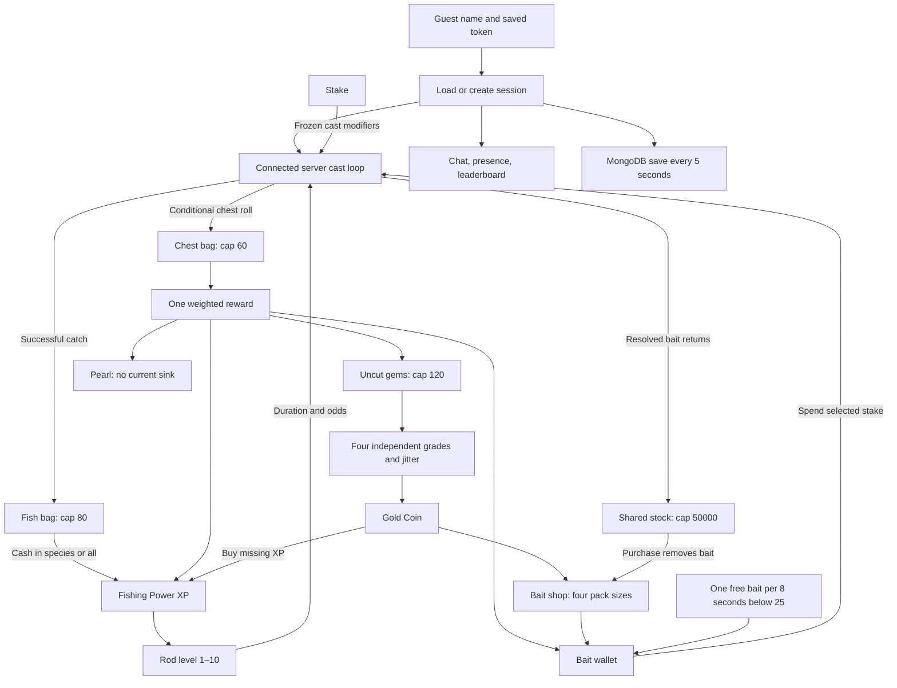

# Harbor Systems Map

Current implementation, 5 September 2026. See [GDD](GDD.md) and [balance tables](balance-tables.md) for complete rules and odds.

Catches award no Gold and no immediate XP. Chests award no direct Gold. Gems are a minority chest outcome; XP is the most likely. Sparks and Bonus Catch are removed. Legacy consumables remain usable but have no current acquisition path. Regeneration has capped return-session catch-up; there is no offline catch simulation. A full fish bag blocks casts, a full chest bag loses new chest drops, and a full gem bag rerolls gem rewards over the remaining chest entries.
